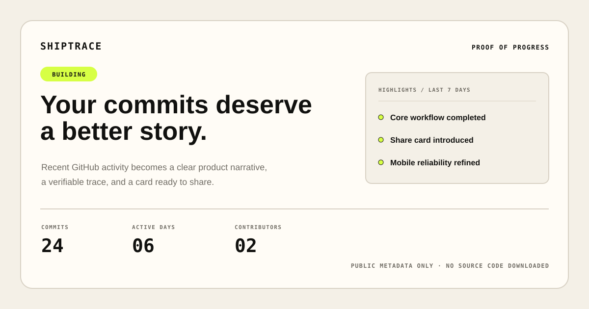

<div align="center">

# SHIPTRACE

**Turn commits into proof of progress.**

Shiptrace turns recent public GitHub activity into a clear product story, a persistent trace page, and a shareable proof card.


</div>



## Why Shiptrace exists

GitHub records technical activity, but commit history rarely explains what actually moved forward. Product work becomes a stream of terse messages—useful to developers, difficult for everyone else to understand or share.

Shiptrace converts that activity into trustworthy proof of progress:

```text
Public repository → 7 or 30 days → GitHub metadata → AI/fallback analysis → Public trace → Share card
```

It does not clone repositories, download source code, inspect diffs, or claim impact that is not supported by commit evidence.

## What it produces

- A concise, product-level progress headline and summary
- Commit, active-day, and contributor metrics
- Grounded highlights linked to source commits
- Changes grouped as feature, fix, improvement, infrastructure, documentation, or maintenance
- A receipt-inspired proof-of-progress view
- LinkedIn and X copy with clipboard feedback
- A 1200×630 dynamic Open Graph card
- A deterministic fallback report when the AI provider is unavailable

## Product principles

- **Evidence over hype.** Every claim must be supported by supplied commit metadata.
- **Public metadata only.** Repository source and diffs are never downloaded.
- **Failure should degrade gracefully.** GitHub, AI, and persistence failures have explicit states.
- **One excellent path.** No accounts, dashboards, payments, private repositories, or unrelated SaaS surface area.
- **Calm by design.** Responsive editorial layout, restrained motion, keyboard access, and reduced-motion support.

## Stack

| Layer | Technology |
|---|---|
| Application | Next.js 16 App Router, React 19, strict TypeScript |
| Styling | Tailwind CSS 4, Geist Sans, Geist Mono |
| Validation | Zod |
| Repository data | GitHub REST API |
| Analysis | Groq Responses API with `openai/gpt-oss-120b` |
| Persistence | Supabase Postgres with Row Level Security |
| Share images | `next/og` |
| Quality | Node test runner, ESLint, TypeScript, GitHub Actions |

## Quick start

Requirements:

- Node.js 20.9 or newer
- npm

```bash
npm install
cp .env.example .env.local
npm run dev
```

Windows PowerShell:

```powershell
Copy-Item .env.example .env.local
npm.cmd run dev
```

Open [http://localhost:3000](http://localhost:3000).

Shiptrace can run locally without external credentials:

- Without `GROQ_API_KEY`, it uses the deterministic fallback analyzer.
- Without Supabase credentials, development uses an in-memory trace store.
- Without `GITHUB_TOKEN`, public GitHub requests still work but reach rate limits sooner.

## Environment variables

Copy `.env.example` to `.env.local`. Never commit `.env.local` or paste secrets into issues, screenshots, or logs.

| Variable | Required | Purpose |
|---|---:|---|
| `GITHUB_TOKEN` | No | Raises GitHub's public REST API rate limit; server-only |
| `GROQ_API_KEY` | No | Enables GPT-OSS analysis; server-only |
| `GROQ_MODEL` | No | Defaults to `openai/gpt-oss-120b` |
| `NEXT_PUBLIC_SUPABASE_URL` | Persistent mode | Supabase project URL |
| `NEXT_PUBLIC_SUPABASE_PUBLISHABLE_KEY` | Persistent mode | RLS-protected public trace reads |
| `SUPABASE_SECRET_KEY` | Persistent mode | Server-only trace inserts; bypasses RLS |
| `NEXT_PUBLIC_APP_URL` | No | Application origin; defaults to `http://localhost:3000` locally |

Variables containing secrets must never use the `NEXT_PUBLIC_` prefix. Supabase's URL and publishable key are intentionally public; its secret key is not. Legacy `NEXT_PUBLIC_SUPABASE_ANON_KEY` and `SUPABASE_SERVICE_ROLE_KEY` names remain supported for existing local setups, but new installations should use the variables above.

## Persistent Supabase setup

1. Create a Supabase project.
2. Open **SQL Editor**.
3. Run [`supabase/migrations/202607210001_create_traces.sql`](supabase/migrations/202607210001_create_traces.sql) once.
4. Confirm that `public.traces` exists and Row Level Security is enabled.
5. Add the project URL, publishable key, and secret key to `.env.local`.
6. Restart the development server after changing environment variables.

The migration allows public reads while revoking client-side insert, update, and delete access. New traces are written only by the server route using the service-role credential.

## Architecture

```text
Browser
  └─ POST /api/analyze
       ├─ validate and parse owner/repository
       ├─ fetch GitHub repository + recent commits
       ├─ normalize commits and mark maintenance noise
       ├─ request strict structured analysis from Groq
       ├─ retry once, then use deterministic fallback
       ├─ validate the result with Zod
       ├─ persist or deduplicate the trace
       └─ return /t/[slug]

/t/[slug]
  ├─ server-rendered trace story
  ├─ source commit links
  ├─ social copy tools
  └─ /api/og/[slug] → 1200×630 share card
```

## Commands

```bash
npm run dev        # Start the development server
npm run lint       # Run ESLint
npm run typecheck  # Run strict TypeScript checks
npm test           # Run the automated test suite
npm run build      # Create a production build
npm start          # Serve the production build
```

## Security and trust model

- Commit messages are untrusted input and are isolated inside explicit prompt boundaries.
- Model output is schema-validated and checked against the supplied commit SHAs.
- GitHub, Groq, and Supabase elevated credentials remain server-only.
- Public trace reads are protected by Supabase RLS policy.
- The AI provider receives repository metadata and commit messages—not source files or diffs.
- Production analysis routes use basic in-memory IP and repository limits.

See [SECURITY.md](SECURITY.md) for private vulnerability reporting and credential-response guidance.

## Repository structure

```text
app/                     Next.js routes, trace pages, and OG image endpoint
components/              Landing, motion, and trace UI
lib/ai/                  Prompting, Groq adapter, validation, and fallback
lib/github/              GitHub client, schemas, normalization, and errors
lib/persistence/         Supabase mapping, validation, slugs, and storage
supabase/migrations/     Database schema and RLS policy
tests/                   Analysis, GitHub, persistence, and rate-limit tests
docs/                    Product, design, architecture, copy, and flow specs
```

Start with [DOCS_INDEX.md](DOCS_INDEX.md) for the complete product documentation.

## Current limitations

- Public GitHub repositories only
- Analysis windows are limited to 7 or 30 days
- The newest 100 commits are analyzed; larger windows are displayed as `100+`
- No authentication, dashboard, private repository support, webhook, or trace editor
- In-memory production rate limiting is not globally consistent across serverless instances
- There is no official hosted Shiptrace instance

## Contributing

Focused contributions are welcome. Read [CONTRIBUTING.md](CONTRIBUTING.md), follow the [Code of Conduct](CODE_OF_CONDUCT.md), and use the provided issue or pull request templates.

The project intentionally rejects scope that does not strengthen the core proof-of-progress flow.

## License

Shiptrace is licensed under the [GNU Affero General Public License v3.0 only](LICENSE).

If you modify Shiptrace and make that modified version available to users over a network, the AGPL requires you to offer those users the corresponding source code under the same license. See the complete license text for the controlling terms.

The software license does not grant rights to the Shiptrace name, wordmark, or visual identity. See [TRADEMARKS.md](TRADEMARKS.md).

Copyright © 2026 Shiptrace contributors.
